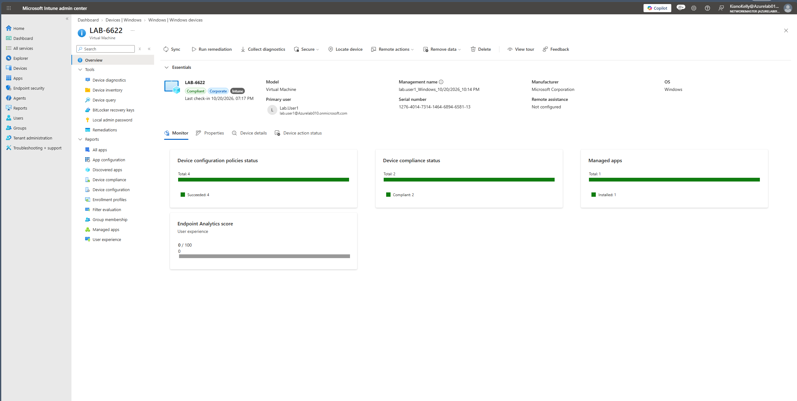

# Intune + Autopilot Lab

Zero-touch Windows 11 provisioning with Microsoft Intune and Windows Autopilot, built in a Microsoft 365 Business Premium trial tenant with a Hyper-V virtual machine.

A brand-new VM was registered in Autopilot with its hardware hash. When a user signed in for the first time, the device named itself, joined Microsoft Entra ID, enrolled in Intune, installed its required app, and picked up compliance, BitLocker, and Windows Update policies with no manual setup. Along the way I troubleshot a failed hardware hash upload, a BitLocker activation failure, and a compliance assignment gap. Those fixes are documented in [docs/troubleshooting.md](docs/troubleshooting.md) and as Jira Service Management incidents in [tickets/](tickets/).

**Built:** October 2026 · **Author:** Kiano Kelly


## Results

| Check | Result | Proof |
|---|---|---|
| Device registered in Autopilot, profile assigned | ✅ | [20](screenshots/20-autopilot-profile-assigned.png) |
| Device joined the dynamic Autopilot group automatically | ✅ | [21](screenshots/21-autopilot-devices-group-member.png) |
| Device named itself from the template (`LAB-6622`) | ✅ | [23](screenshots/23-hostname-lab-6622.png) |
| Entra joined, enrolled in Intune, primary user set | ✅ | [39](screenshots/39-compliant-after-remote-restart.png) |
| Company Portal installed with no user action | ✅ | [39](screenshots/39-compliant-after-remote-restart.png) |
| BitLocker on with TPM protector | ✅ | [33](screenshots/33-manage-bde-protection-on.png) |
| BitLocker recovery key backed up to Entra ID | ✅ | [32](screenshots/32-bitlocker-success-events.png) |
| Device marked **Compliant** (2 of 2 compliance policies, 4 of 4 configuration policies) | ✅ | [39](screenshots/39-compliant-after-remote-restart.png), [36](screenshots/36-devices-list-compliant.png) |
| Remote Sync and remote Restart sent from Intune | ✅ | [35](screenshots/35-device-compliant.png) (after Sync), [39](screenshots/39-compliant-after-remote-restart.png) (after Restart) |
| Incidents documented in Jira Service Management | ✅ | [37](screenshots/37-jira-help-3.png), [38](screenshots/38-jira-help-4.png) |

<!-- Add later: screenshots/40-remote-restart-device-action-status.png and screenshots/41-bitlocker-recovery-key-redacted.png -->




## Environment

| Component | Details |
|---|---|
| Tenant | Microsoft 365 Business Premium trial (includes Intune P1 and Entra ID P1) |
| Identity | Cloud-only, Microsoft Entra joined. Separate from my Windows Server Active Directory lab |
| Hypervisor | Hyper-V on Windows 11 |
| Test VM | Generation 2, 4 GB static RAM, 64 GB disk, vTPM + Secure Boot, Default Switch for internet |
| OS | Windows 11 Enterprise Evaluation, version 25H2 (build 26200) |
| Ticketing | Jira Service Management (IT Help Desk space) |

---

## What I configured

| Area | Object | Key settings |
|---|---|---|
| Users | Kiano Kelly | Global Administrator; used to configure Intune and upload the hardware hash |
| | Lab.User1, Lab User2 | Standard test users; Lab.User1 enrolled the device |
| Licensing | All three accounts | Microsoft 365 Business Premium (includes Intune P1 and Entra ID P1) |
| Groups | `Lab-Users` | Assigned security group (test users) |
| | `Autopilot-Devices` | Dynamic device group: `(device.devicePhysicalIDs -any (_ -startsWith "[ZTDId]"))` |
| Enrollment | Automatic enrollment | MDM user scope: **All** |
| Autopilot | Deployment profile | User-driven, Entra joined, OOBE screens hidden, standard user, name template `LAB-%RAND:4%` |
| | `Lab-ESP` | Show progress, block device use until apps and profiles install, 60-minute timeout |
| Compliance | Compliance policy | Minimum OS 10.0.22000, password required, encryption required. Assigned to users **and** devices |
| Endpoint security | `Lab_BitLocker` | Silent encryption, standard-user encryption allowed, used-space-only, recovery key escrowed to Entra ID |
| Updates | `Lab_Update_Ring` | Quality deferral 0 days, feature deferral 30 days, active hours 8 AM–5 PM |
| Apps | Company Portal | Microsoft Store app (new), install as System, **Required** for `Lab-Users` |

Full step-by-step instructions with every setting: [docs/build-guide.md](docs/build-guide.md).

---

## Troubleshooting highlights

| Problem | Root cause | Fix |
|---|---|---|
| Hardware hash upload failed repeatedly at the setup screen | Fresh OS had no PowerShell Gallery registered, Graph sign-in (WAM) crashed PowerShell, then a DNS lookup failed | Registered PSGallery, installed Graph auth module, disabled WAM, re-ran after DNS resolved |
| Device **Not compliant**: encryption rule failed | No BitLocker policy existed, **and** the Windows ISO was still attached (BitLocker Event 853) | Created the BitLocker policy, removed the ISO, restarted |
| Default policy error **65001** | Compliance policy assigned to a user group only, so the device-context check found no policy | Assigned the compliance policy to the device group too, then sent a remote Sync and Restart |

All 13 issues, with symptoms, causes, and fixes: [docs/troubleshooting.md](docs/troubleshooting.md).

---

## Skills demonstrated

| Job posting phrase | Where this lab shows it |
|---|---|
| Intune / MDM / endpoint management | Device enrolled, managed, and monitored in Intune |
| Windows Autopilot / device provisioning | Zero-touch setup from hardware hash to user desktop |
| Microsoft Entra ID | Users, assigned and dynamic groups, Entra join |
| Compliance policies | Device evaluated and marked Compliant; fixed a user-vs-device assignment gap |
| Endpoint security / BitLocker | Encryption pushed by Intune, key escrowed to the cloud, root cause found in the event log |
| Patch management | Windows Update ring with deferral periods and active hours |
| Application deployment | Required app installed automatically during enrollment |
| Remote device support | Remote Sync and Restart from the Intune console |
| PowerShell | Autopilot hash upload, module and repository repair, BitLocker diagnostics |
| ITSM / ticketing | Incidents logged, investigated, and resolved in Jira Service Management |

---

## Repository layout

```
intune-autopilot-lab/
├── README.md
├── docs/
│   ├── build-guide.md        # Step-by-step build with every setting
│   ├── troubleshooting.md    # Every problem: symptom, cause, fix
│   ├── lessons-learned.md
│   └── notes.md              # Plain-language notes and PowerShell reference
├── tickets/
│   ├── HELP-3-bitlocker-blocked-by-iso.md
│   └── HELP-4-compliance-policy-assignment.md
└── screenshots/              # 01–39, in build order
```
