# Build Guide

Step-by-step build of the lab, in the order I did it. Portal menus move around, so if a path doesn't match exactly, look for the same setting name nearby.

**Time:** about one day of hands-on work. Most of the waiting is profile assignment and policy sync (15–30 minutes each).

---

## 0. Prerequisites

1. **Confirm Hyper-V is enabled** (admin PowerShell on the host):
```powershell
   Get-WindowsOptionalFeature -Online -FeatureName Microsoft-Hyper-V
```
   `State : Enabled` means you're ready.
2. **Download Windows 11 Enterprise Evaluation** (ISO, 64-bit, English) from the Microsoft Evaluation Center. It's about 6 GB, so start it early.
3. **Start a Microsoft 365 Business Premium trial.** It's the only Business plan that includes Intune. Use a new email so you get a clean tenant. The trial needs a card and converts to a paid subscription after 30 days, so set a cancel reminder a week before the end date.

---

## 1. Tenant setup

### Users
**Microsoft 365 admin center → Users → Active users → Add a user**

| Account | Role | License |
|---|---|---|
| Kiano Kelly | Global Administrator (created with the trial) | Microsoft 365 Business Premium |
| Lab.User1 | Standard test user; enrolled the device | Microsoft 365 Business Premium |
| Lab User2 | Standard test user | Microsoft 365 Business Premium |

- Test users were created with passwords set manually and "require change at next sign-in" turned off.
- Every user who signs in to a managed device needs a license that includes Intune.
- The admin account is only used for configuration and the hardware hash upload. The device is enrolled by a standard user, the way it would be for a real employee.

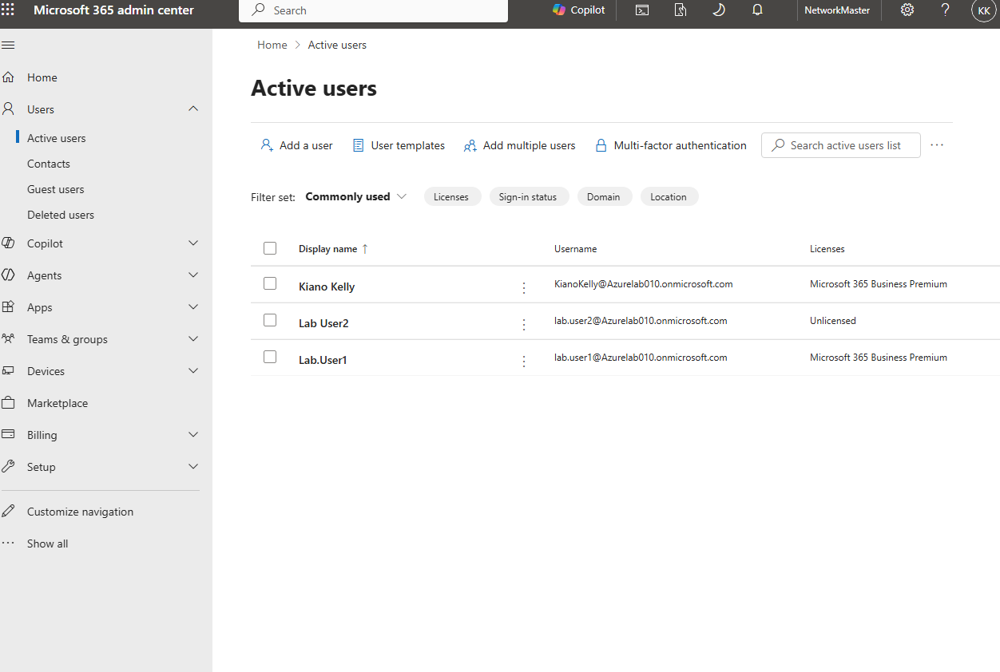

### Automatic enrollment
**Intune admin center → Devices → Windows → Enrollment → Automatic Enrollment → Microsoft Intune**

- **MDM user scope:** All
- **WIP user scope:** None (WIP without enrollment is retired)

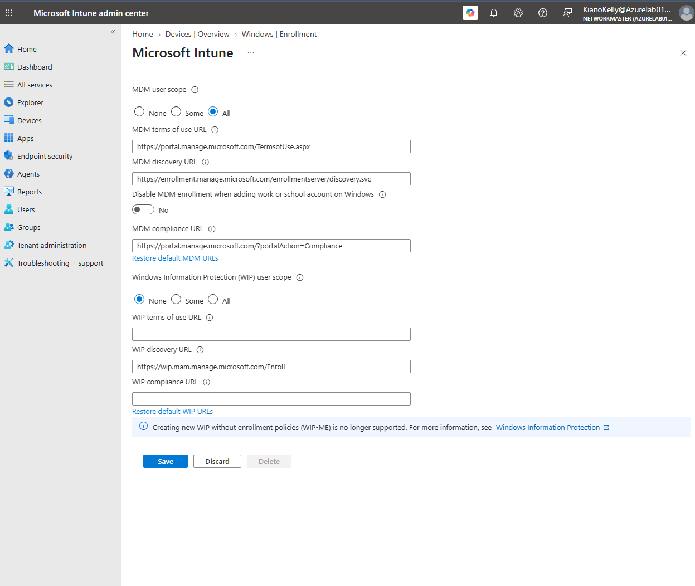

---

## 2. Groups

**Intune admin center → Groups → New group**

### Lab-Users
- Group type: Security · Membership type: **Assigned**
- Members: Lab.User1, Lab User2
- "Microsoft Entra roles can be assigned to the group": **off** (only needed for admin-role groups, and it can't be changed later)

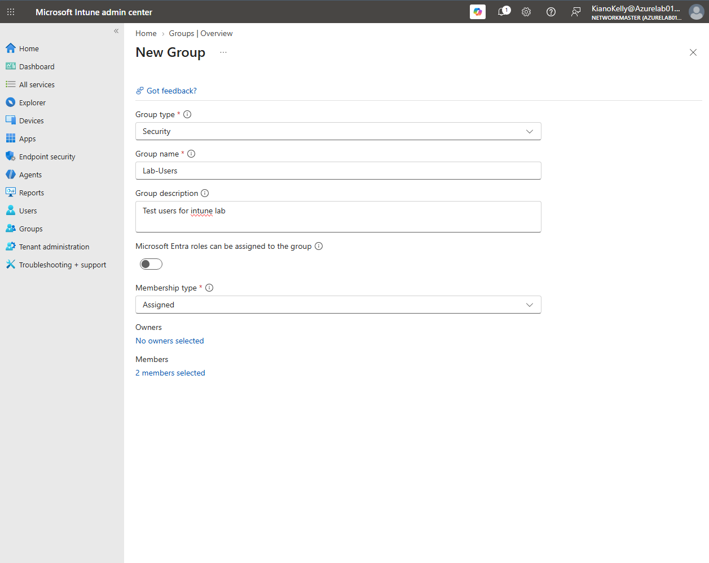

### Autopilot-Devices
- Group type: Security · Membership type: **Dynamic Device**
- Rule syntax (type it, don't trust a paste):
```
  (device.devicePhysicalIDs -any (_ -startsWith "[ZTDId]"))
```
  `[ZTDId]` is the tag Autopilot puts on every device registered with a hardware hash (ZTD = Zero Touch Deployment). Any registered device joins this group automatically.

> My first attempt was rejected as invalid because the paste added extra quote marks. See [troubleshooting #1](troubleshooting.md#1-dynamic-group-rule-rejected-as-invalid).

---

## 3. Autopilot profile and Enrollment Status Page

### Deployment profile
**Devices → Windows → Enrollment → Windows Autopilot → Deployment Profiles → Create profile → Windows PC**

| Setting | Value |
|---|---|
| Convert all targeted devices to Autopilot | No |
| Deployment mode | User-Driven |
| Join to Microsoft Entra ID as | Microsoft Entra joined |
| License terms / Privacy settings / Change account options | Hide |
| User account type | Standard |
| Allow pre-provisioned deployment | No |
| Apply device name template | Yes: `LAB-%RAND:4%` |
| Assignment | Autopilot-Devices |

`LAB-%RAND:4%` gives names like `LAB-6622`. Windows device names are limited to 15 characters.

### Enrollment Status Page
**Devices → Windows → Enrollment → Enrollment Status Page → Create**

| Setting | Value |
|---|---|
| Show app and profile configuration progress | Yes |
| Error timeout | 60 minutes |
| Log collection and diagnostics page for end users | Yes |
| Only show page to devices provisioned by OOBE | Yes |
| Block device use until all apps and profiles are installed | Yes |
| Allow reset / allow use if installation error occurs | Yes / Yes |
| Block device use until required apps are installed | All |
| Assignment | Autopilot-Devices |

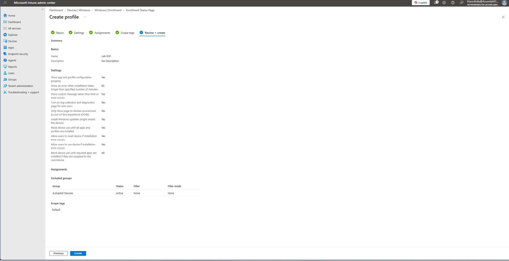

---

## 4. Policies

### Compliance policy
**Devices → Windows → Compliance → Create policy → Windows 10 and later → Windows 10/11 compliance policy** (not the "custom" one)

| Setting | Value |
|---|---|
| Minimum OS version | 10.0.22000 (any Windows 11) |
| Require a password to unlock | Require |
| Encryption of data storage on device | Require |
| Action for noncompliance | Mark device noncompliant, immediately |
| Assignment | Lab-Users **and Autopilot-Devices** |

I used **Encryption of data storage on device** instead of **Require BitLocker** because the BitLocker health-attestation check is unreliable on Hyper-V VMs.

> I originally assigned this to Lab-Users only, which caused a device-context error. Assign to both a user group and a device group. See [troubleshooting #12](troubleshooting.md#12-default-policy-error-65001).

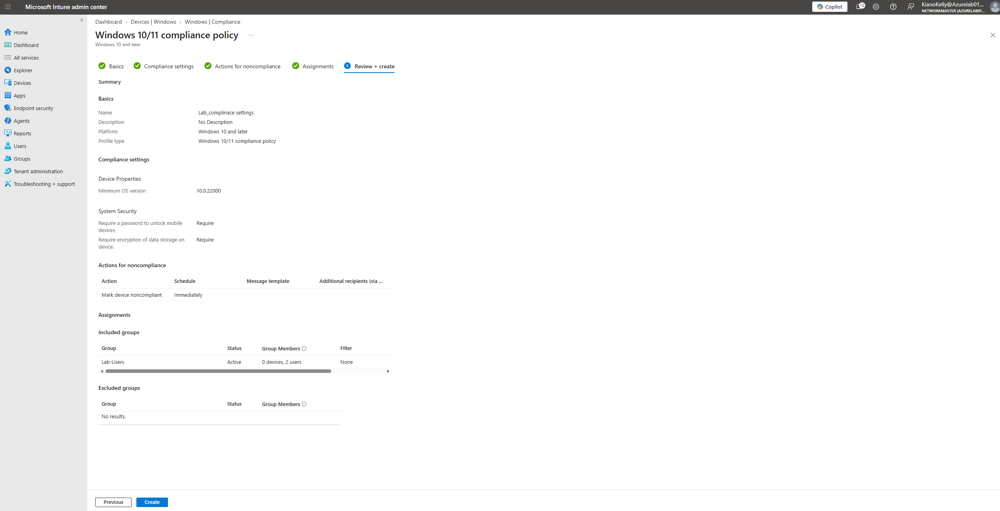

### BitLocker
**Endpoint security → Disk encryption → Create Policy → Windows → BitLocker**

| Setting | Value |
|---|---|
| Require Device Encryption | Enabled |
| Allow Warning For Other Disk Encryption | Disabled |
| Allow Standard User Encryption | Enabled |
| Enforce drive encryption type (OS drive) | Enabled: Used Space Only |
| Choose how OS drives can be recovered | Enabled |
| Save recovery information to AD DS | True (on Entra-joined devices this saves to Entra ID) |
| Do not enable BitLocker until recovery info is stored | True |
| Assignment | Autopilot-Devices |

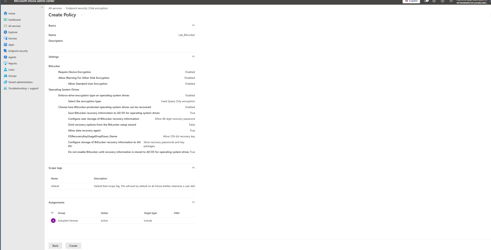

### Windows Update ring
**Devices → Windows → Windows updates → Update rings → Create**

| Setting | Value |
|---|---|
| Quality update deferral | 0 days |
| Feature update deferral | 30 days |
| Servicing channel | General Availability |
| Automatic update behavior | Auto install at maintenance time |
| Active hours | 8 AM – 5 PM |
| Assignment | Autopilot-Devices |

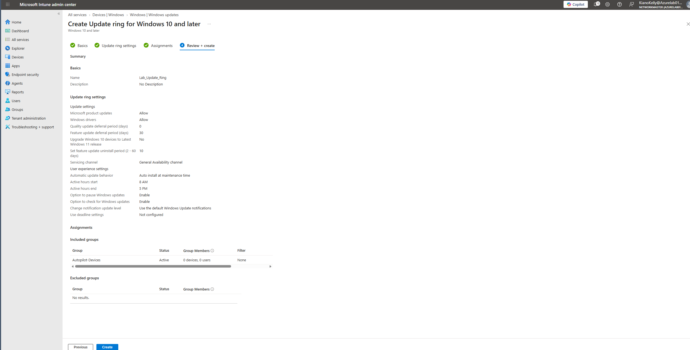

---

## 5. App deployment

**Apps → Windows → Add → Microsoft Store app (new) → search "Company Portal"** (publisher: Microsoft Corporation)

- Install behavior: **System**
- Assignment: **Required** → Lab-Users

I chose Company Portal over Edge because Edge is already on Windows 11, so it wouldn't prove Intune installed anything.

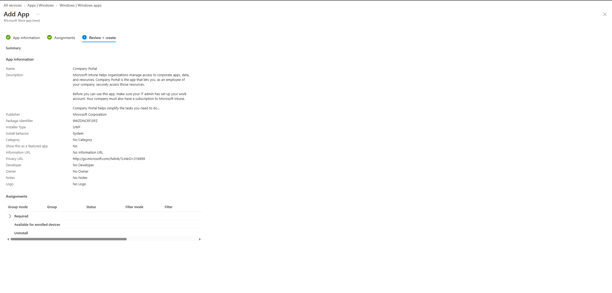

---

## 6. Build and register the VM

### Create the VM (Hyper-V Manager → New → Virtual Machine)
- Generation 2 · 4096 MB, dynamic memory **off** · **Default Switch** · 64 GB disk · Windows 11 ISO as install media
- Before first boot: **Settings → Security → Enable Trusted Platform Module** and confirm Secure Boot is on

Install Windows and stop at the **"Let's set things up for your work or school"** screen. **Do not sign in yet.**

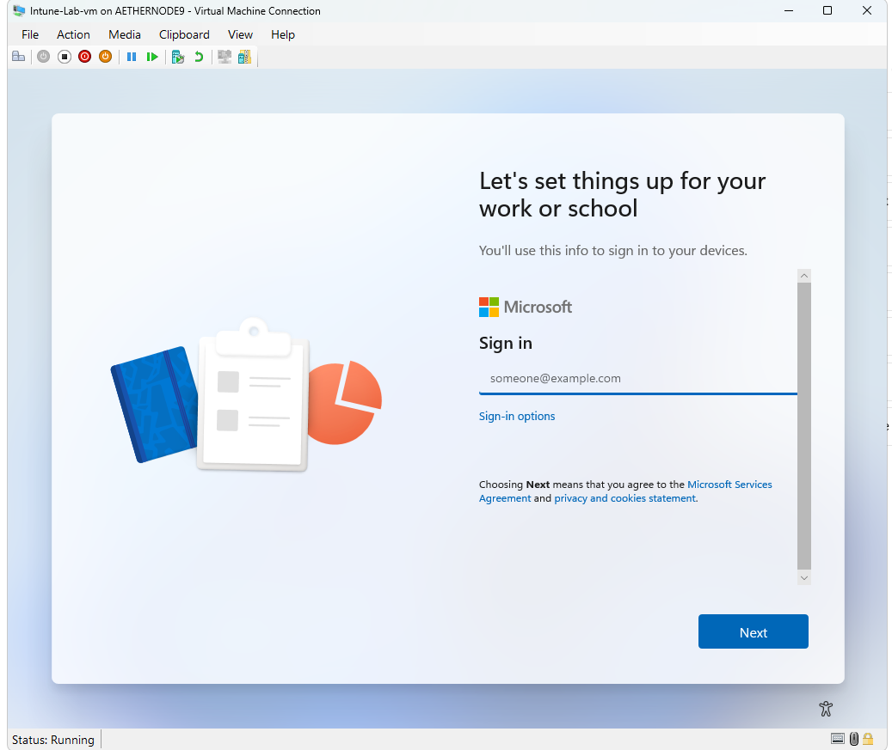

### Upload the hardware hash
1. Press **Shift+F10** to open Command Prompt, then type `powershell`.
2. Confirm the TPM: `Get-Tpm` → `TpmPresent : True`
3. Run the upload. On a fresh install, these extra steps were needed (see [troubleshooting #3–#8](troubleshooting.md#3-powershell-closed-during-sign-in-wam)):

```powershell
Set-ExecutionPolicy -Scope Process -ExecutionPolicy Bypass
Install-PackageProvider -Name NuGet -MinimumVersion 2.8.5.201 -Force
Register-PSRepository -Default                       # only if Get-PSRepository shows nothing
Install-Module Microsoft.Graph.Authentication -Force -Scope AllUsers
Set-MgGraphOption -DisableLoginByWAM $true
Install-Script -Name Get-WindowsAutopilotInfo -Force
Get-WindowsAutopilotInfo -Online
```

4. Sign in with the **admin** account (Work or school account), choose **"sign in to this app only,"** and accept the Microsoft Graph Command Line Tools permissions (verified Microsoft publisher).

   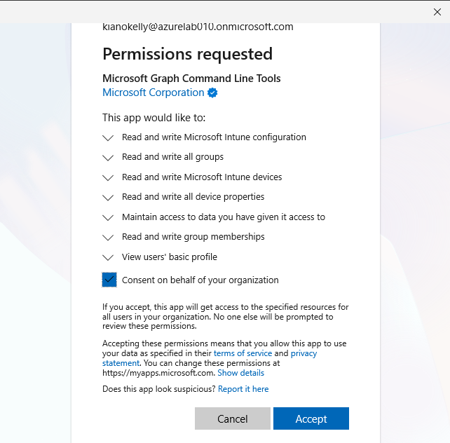

5. Wait for `1 devices imported successfully` and `All devices synced`.

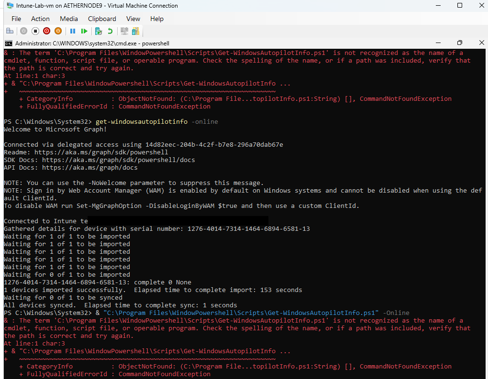

### Wait for the profile
**Devices → Windows → Enrollment → Windows Autopilot → Devices.** Click Sync and Refresh until **Profile status** changes from Pending to **Assigned**. Don't restart before that, or the device runs normal setup instead of Autopilot. The device has to join the dynamic group first, then receive the profile.

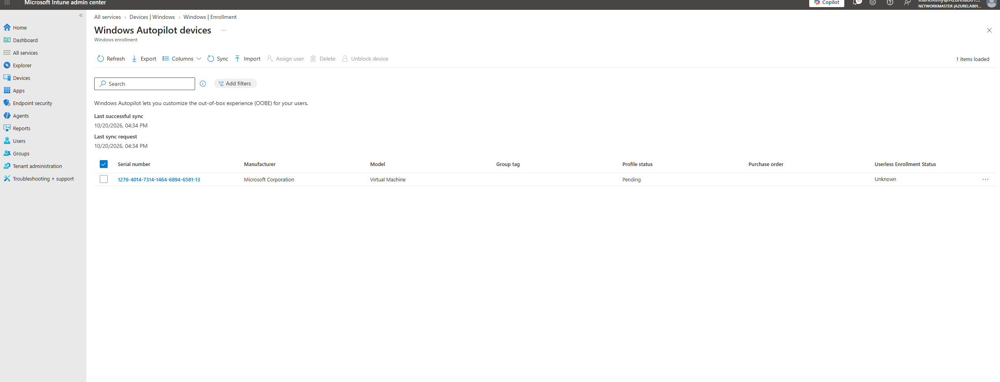
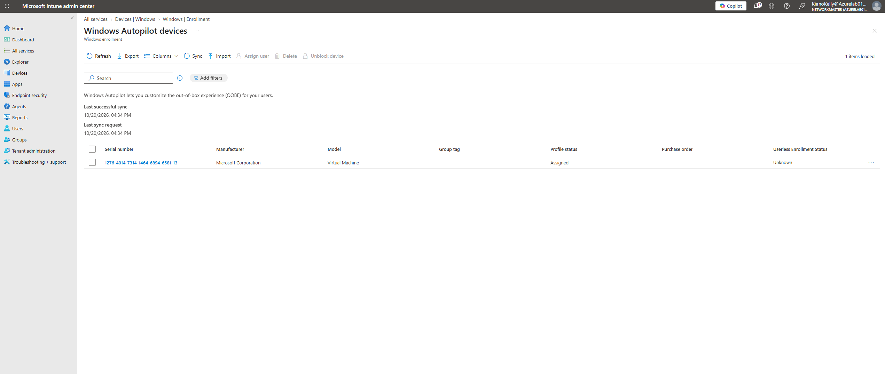
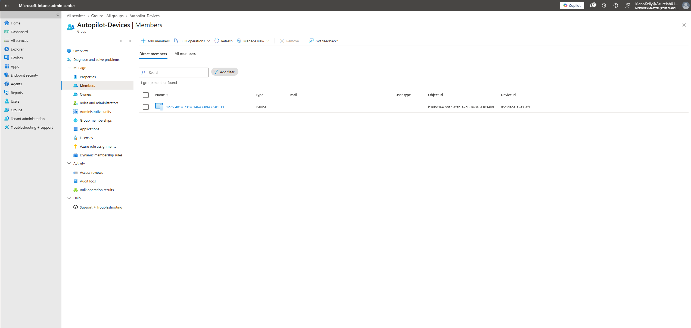

---

## 7. Enroll and verify

1. Restart from the setup-screen PowerShell: `shutdown /r /t 0`
2. Sign in as **lab.user1**. Complete MFA registration if prompted, and set a Windows Hello PIN at the end.
3. Let setup run (10–30 minutes).

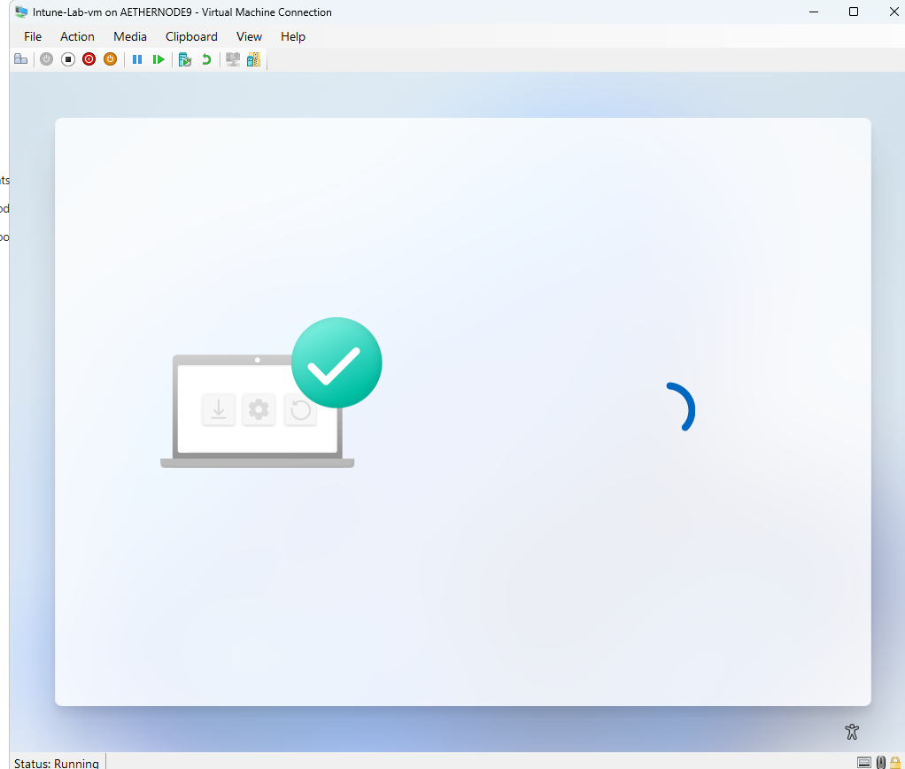

4. Verify:
   - `hostname` returns `LAB-####` ([23](../screenshots/23-hostname-lab-6622.png))
   - Device shows in Intune with primary user Lab.User1
   - Company Portal installed (Managed apps: Installed 1)
   - `manage-bde -status C:` shows **Protection On** with TPM and Numerical Password protectors ([33](../screenshots/33-manage-bde-protection-on.png))
   - Device is **Compliant**
5. Help desk actions from the device page in Intune: **Sync**, then **Remote actions → Restart**, and check **Device action status**.
   - After the Sync, the device showed **Compliant**, but some reports were still catching up ([35](../screenshots/35-device-compliant.png)).
   - After the remote Restart, every report was clean: **Compliant: 2**, **Succeeded: 4**, **Installed: 1** ([39](../screenshots/39-compliant-after-remote-restart.png)).


> Before this worked end to end, I had to fix BitLocker and the compliance assignment. See [troubleshooting #9–#13](troubleshooting.md#9-encryption-rule-failed-no-bitlocker-policy).

---

## 8. Document

- Screenshots in build order (`screenshots/`)
- Incidents logged and resolved in Jira Service Management (`tickets/`)
- Cancel the trial before it converts to paid
