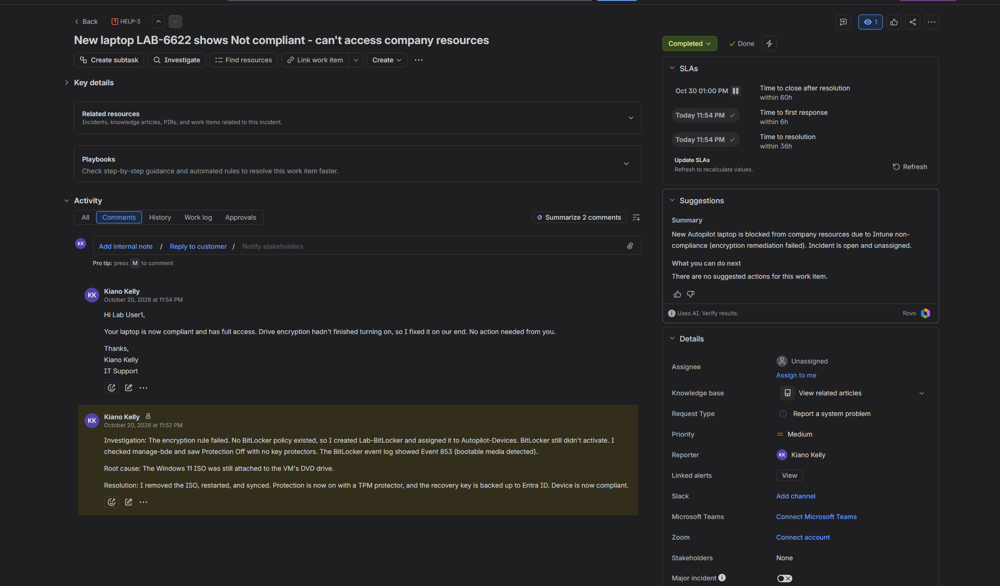

# HELP-3: New laptop LAB-6622 shows Not compliant - can't access company resources

| Field | Value |
|---|---|
| **Work type** | Incident |
| **Request type** | Report a system problem |
| **Priority** | Medium |
| **Status** | Completed (Resolution: Done) |
| **Device** | LAB-6622 (Windows 11 Enterprise, Autopilot-provisioned) |
| **Opened / Resolved** | October 20, 2026 |
| **Related** | [HELP-4](HELP-4-compliance-policy-assignment.md) |

## Description (user report)

My new laptop (LAB-6622) was set up through Autopilot today. After signing in, Company Portal says the device can't access company resources, and Check access fails. Intune shows the device as Not compliant. The encryption requirement shows "Remediation failed."

## Internal note

**Investigation:** The encryption rule failed. No BitLocker policy existed, so I created Lab-BitLocker and assigned it to Autopilot-Devices. BitLocker still didn't activate. I checked manage-bde and saw Protection Off with no key protectors. The BitLocker event log showed Event 853 (bootable media detected).

**Root cause:** The Windows 11 ISO was still attached to the VM's DVD drive.

**Resolution:** I removed the ISO, restarted, and synced. Protection is now on with a TPM protector, and the recovery key is backed up to Entra ID. Device is now compliant.

## Reply to customer

> Hi Lab User1,
>
> Your laptop is now compliant and has full access. Drive encryption hadn't finished turning on, so I fixed it on our end. No action needed from you.
>
> Thanks,
> Kiano Kelly
> IT Support

## Evidence

| Step | Screenshot |
|---|---|
| Encryption rule error (2016281112) | [26](../screenshots/26-encryption-rule-error.png) |
| BitLocker waiting for activation | [27](../screenshots/27-bitlocker-waiting-for-activation.png) |
| `manage-bde` Protection Off + Event 853 | [30](../screenshots/30-manage-bde-event-853.png) |
| ISO removed (DVD Drive: None) | [31](../screenshots/31-iso-removed-dvd-none.png) |
| Success events 845 / 775 / 892 / 774 | [32](../screenshots/32-bitlocker-success-events.png) |
| `manage-bde` Protection On, TPM + Numerical Password | [33](../screenshots/33-manage-bde-protection-on.png) |

## Prevention

- Remove install media (ISO or USB) after imaging, before the device goes to the user.
- Confirm a BitLocker policy exists and is assigned to the device group before enrolling devices.
