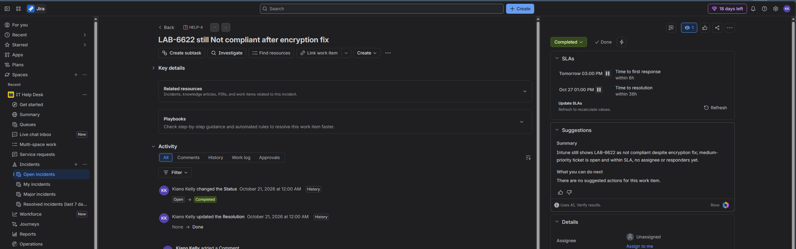

# HELP-4: LAB-6622 still Not compliant after encryption fix

| Field | Value |
|---|---|
| **Work type** | Incident |
| **Request type** | Report a system problem |
| **Priority** | Medium |
| **Status** | Completed (Resolution: Done) |
| **Device** | LAB-6622 (Windows 11 Enterprise, Autopilot-provisioned) |
| **Opened / Resolved** | October 20–21, 2026 |
| **Related** | [HELP-3](HELP-3-bitlocker-blocked-by-iso.md) |

## Description (user report)

Encryption was fixed on LAB-6622, but the device still shows Not compliant in Intune. The Default Device Compliance Policy shows "Has a compliance policy assigned: Error 65001 (Not applicable)."

## Internal note

**Investigation:** The Default policy showed error 65001. Lab-Compliance was assigned only to Lab-Users, so the System account (device) check found no policy.

**Root cause:** The compliance policy was assigned to users only.

**Resolution:** I added Autopilot-Devices to the Lab-Compliance assignments, then sent a remote Sync and Restart. Device is now compliant.

## Reply to customer

> Hi Lab User1,
>
> Your laptop is now compliant and has full access. A setting on our end wasn't applied to your device, so I fixed it. No action needed from you.
>
> Thanks,
> Kiano Kelly
> IT Support

## Evidence

| Step | Screenshot |
|---|---|
| Both policies in Error (user and System account check-ins) | [25](../screenshots/25-compliance-policy-errors.png) |
| Default policy: Has a compliance policy assigned, Error 65001 | [34](../screenshots/34-default-policy-65001.png) |
| Device Compliant after Sync (Calculating compliance: Compliant) | [35](../screenshots/35-device-compliant.png) |
| Windows devices list showing Compliant | [36](../screenshots/36-devices-list-compliant.png) |

## Prevention

- Assign compliance policies to both a user group and a device group, so both the user and device evaluations find a policy.
